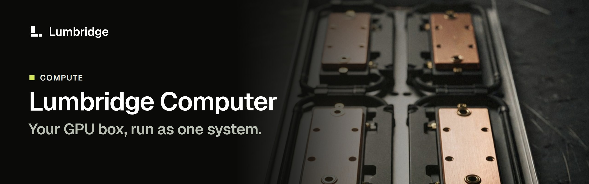
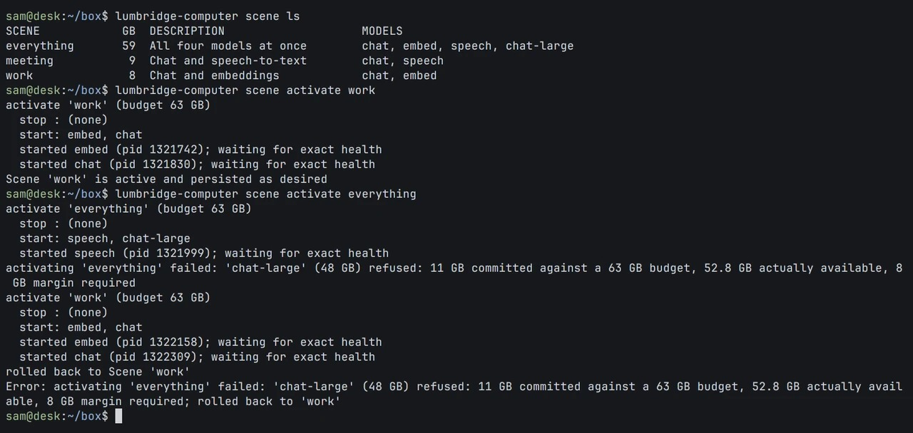

# Lumbridge Computer

Lumbridge Computer runs the AI models on one machine and keeps that machine
from running out of memory. It is for people who self-host several models
(a chat model, speech, embeddings) on one box with unified memory. What makes
it different: every model is admitted against a memory budget before it starts,
and a busy model is never restarted for being slow.

Part of [Lumbridge](https://lumbridgecorp.com) ([all repos](https://github.com/lumbridge-corp)). In daily use.

It is one Rust binary, `lumbridge-computer`, with three jobs:

| Part | What it does |
|---|---|
| **Models** | Scenes (named sets of models), memory admission on one unified pool, a watchdog that sheds models before the box wedges, process ownership that survives agent restarts, supervision, sleep and on-demand models, an OpenAI-compatible gateway, telemetry, evals |
| **Supabase** | The box's self-hosted Supabase (upstream compose plus an overlay): loopback-only ports, a memory reservation and a kernel memory floor, install and health checks |
| **Tailscale** | What the box publishes on your tailnet, declared in a config file and checked for drift |



## Status

- **Version:** 0.1.0. Interfaces can change until 1.0.
- **Runs on:** written for one kind of box: an NVIDIA DGX Spark-class machine
  (GB10, 128 GB unified memory, Linux aarch64). Elsewhere (Linux x86_64 or
  aarch64) you can build it, run the tests, read and dry-run Scenes, and run
  the GPU-free demo below. `doctor` fails on other hardware.
- **Not yet:**
  - No installer or download: you build it from source.
  - No `model pull`: you install model runtimes and weights yourself and
    describe them in the registry.
  - `apply` changes one thing only (the Supabase memory floor); everything
    else it reports as a dry run.
  - Memory pools for other kinds of hardware.

## Install

You need: Rust 1.88 or newer, a C toolchain, Git. Python 3 is used by the demo
only.

On Ubuntu 24.04:

```sh
sudo apt install -y build-essential pkg-config curl git python3
curl --proto '=https' --tlsv1.2 -sSf https://sh.rustup.rs | sh -s -- -y --profile minimal
. "$HOME/.cargo/env"
git clone https://github.com/lumbridge-corp/lumbridge-computer.git
cd lumbridge-computer
cargo build --locked --release
install -Dm755 target/release/lumbridge-computer ~/.local/bin/lumbridge-computer
export PATH="$HOME/.local/bin:$PATH"   # if ~/.local/bin is not on your PATH yet
```

The build writes only to `target/`. The install copies one file to
`~/.local/bin/`. At run time, everything Lumbridge Computer writes goes under
its root, in `.compute/` (state, logs, telemetry). To remove it, delete the
binary and the root's `.compute/` folder, and disable the agent unit if you
installed one.

## Quick start

The demo registry in `examples/demo` has three "models" that are tiny Python
web servers, so you can watch Scenes switch on any Linux machine with no GPU.
Activation keeps an 8 GB safety margin, so the machine needs about 10 GB of
memory available.

```sh
lumbridge-computer --root examples/demo scene ls
lumbridge-computer --root examples/demo scene show one
lumbridge-computer --root examples/demo scene activate one
lumbridge-computer --root examples/demo status
lumbridge-computer --root examples/demo scene activate two
lumbridge-computer --root examples/demo scene deactivate
```

`scene show` prints each model's footprint and the admission verdict.
`scene activate one` starts `alpha` and `beta` and waits until both answer
their health check; `scene activate two` stops what scene two does not need
and starts the rest. `status` shows memory, budget, the running set and
headroom. `deactivate` stops everything it started.

To run real models you need the box described above, the model runtimes and
weights, and your own registry. Start from the reference stack in `registry/`
and `scenes/`, and read [docs/SELF-HOSTING.md](docs/SELF-HOSTING.md).

## Configuration

| What | Where |
|---|---|
| Root (registry, Scenes, state) | `--root <dir>`, else `$LUMBRIDGE_COMPUTER_ROOT`, else the current folder |
| Model registry (trusted, local) | `<root>/registry/models.yaml` |
| Scenes (shareable) | `<root>/scenes/*.scene.yaml` |
| Eval suites | `<root>/evals/*.eval.yaml` |
| State, logs, telemetry | `<root>/.compute/` |
| Box config (`doctor`, `apply`) | `--config <file>`, else `$LUMBRIDGE_COMPUTER_CONFIG`, else `./lumbridge-computer.toml` |

Other environment variables: `LUMBRIDGE_COMPUTER_SCOPES=off` turns per-model
systemd scopes off; `LUMBRIDGE_COMPUTER_LOG=debug` prints debug notes to stderr.

Read commands take `--json` for scripts and agents (`status`, `model ls|show`,
`scene ls|show`, `usage summary|agents|concurrency`, `footprints`, `doctor`,
`apply --dry-run`). The JSON has the same shape the MCP tools and
`lumbridge-computer api` return.

## How it fits the system

Lumbridge Computer works alone. Other Lumbridge parts, and any
OpenAI-compatible client, use the models it serves through its gateway.

| Works with | What passes between them |
|---|---|
| Any OpenAI-compatible client | Chat, embeddings, audio requests to the gateway on `:8011`, routed by `model` |
| AI agents (MCP) | `lumbridge-computer mcp`: status, Scenes and plans as tools over stdio; a real Scene switch only with `--allow-activate` |
| A web UI | `lumbridge-computer api`: the same data as read-only JSON over HTTP |

## What it sends and where

Lumbridge Computer calls no outside service and sends nothing off the machine
on its own. It talks to the models it starts, on their local ports, and to
local tools (`systemd-run`, `nvidia-smi`, `docker`, `tailscale`, `df`). The
resident agent opens the gateway port (`:8011`; the unit files listen on all
interfaces, so other machines on your private network can use it) and the
optional read-only API (`127.0.0.1:8012` by default). Neither has
authentication unless you set `api --token`: keep them off the internet.
Telemetry is stored locally in `.compute/usage/telemetry.sqlite3` and never
holds prompts or model output. `assets/supabase/install.sh` downloads the
pinned Supabase release from GitHub when you run it.

## Docs

- [Scene spec](docs/scene-spec.md): the Scene and registry formats
- [Operations](docs/operations.md): state, switching, the agent, supervision rules
- [Gateway](docs/gateway.md): routing by model, errors, on-demand wake
- [Memory](docs/memory.md): pools, scopes, limits, measured footprints, swap
- [Sleep and on-demand](docs/sleep.md): model states and vLLM sleep
- [The box](docs/box.md): `lumbridge-computer.toml`, `doctor`, `apply`
- [Telemetry](docs/telemetry.md) and [evals](docs/evals.md)
- [Setting up a box](docs/SELF-HOSTING.md) and the [roadmap](docs/roadmap.md)
- [Change log](CHANGELOG.md)

## Contributing

Bug reports and small fixes are welcome. Talk to us in an issue before a large change.
See [CONTRIBUTING.md](CONTRIBUTING.md) for how to build, test and send a pull request.

```sh
scripts/ci.sh
```

## Security

Do not open a public issue for a security problem.
Email security@lumbridgecorp.com or use "Report a vulnerability" on this repo's Security tab.
See [SECURITY.md](SECURITY.md) for the trust model: registries are trusted,
Scenes and eval suites are not.

## Licence

Apache-2.0. See [LICENSE](LICENSE).

Model weights and the third-party runtimes Lumbridge Computer starts are not
part of this repo and have their own licences. `assets/supabase/install.sh`
downloads self-hosted Supabase (Apache-2.0) at install time; none of its files
are in this repo.
